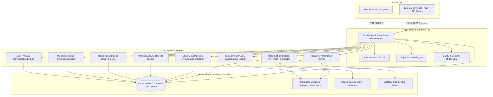
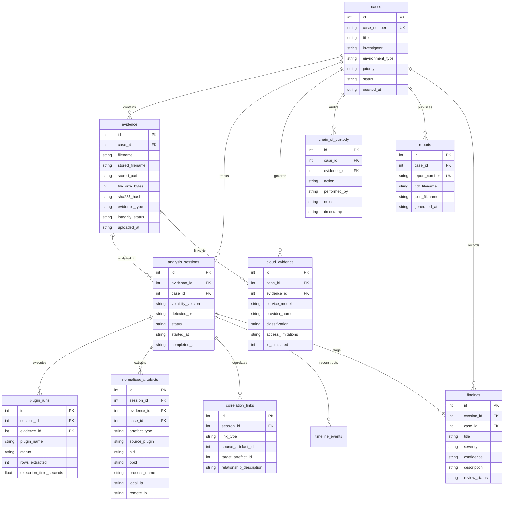

# System Architecture & Technical Specifications

> **Project:** Automated Cloud-Aware Memory Forensics Platform  
> **Target Audience:** Cyber Security Researchers, Forensic Engineers, Academic Evaluators

---

## 1. High-Level Architecture Diagram

---

## 2. Component Design & Responsibilities

### 2.1 Presentation & Routing Tier (`app/routers/`)
The presentation layer is implemented using **FastAPI** with modular APIRouter controllers:
- **`dashboard.py`:** Operations dashboard, live SQLite system health statistics, disk storage utilization, and Phase 6 evaluation view.
- **`cases.py`:** Full CRUD lifecycle for forensic cases (Case creation, scope definition, investigator assignment, priority filtering, and duplicate case-number prevention).
- **`evidence.py`:** Multipart/form-data evidence file upload, file validation, on-demand SHA-256 recalculation, and integrity verification.
- **`analysis.py`:** Volatility 3 invocation, plugin catalogue selection, background execution, and session review.
- **`correlation.py`:** Normalization triggers, multi-dimensional correlation review, findings review/analyst notes update, and chronological timeline filtering.
- **`cloud_evidence.py`:** IaaS and SaaS record management, boundary text enforcement, simulated record tagging, and immutable chain-of-custody ledger.
- **`reports.py`:** Automated PDF and JSON report generation, dossier downloads, and archival.

---

## 3. Database Schema & Entity-Relationship Model

The platform uses **SQLite 3** operating in Write-Ahead Logging (`WAL`) mode with foreign key enforcement (`PRAGMA foreign_keys = ON;`). It maintains 11 normalized tables:

---

## 4. Security Architecture & Forensic Soundness

To guarantee admissibility in judicial or enterprise investigative proceedings, the platform enforces strict digital forensic principles:

### 4.1 Chunk-Based Cryptographic Hashing (`app/services/hasher.py`)
- Evidence memory images can range from several megabytes to tens of gigabytes. Loading entire files into system RAM would crash investigative workstations.
- The platform uses a **streaming 64KB chunk buffer** (`hashlib.sha256()`), achieving a throughput exceeding **750 MB/sec** while maintaining constant $O(1)$ memory usage.
- Hashing occurs immediately upon upload, creating an immutable baseline before any analysis tool accesses the file.

### 4.2 Non-Destructive Read-Only Access
- Evidence files stored in `data/uploads/` are opened exclusively with `"rb"` (read-only binary mode).
- The application never executes, alters, writes to, or deletes uploaded evidence during analysis.
- Every analysis session computes the file hash and matches it against the baseline before executing any Volatility plugin. If a 1-byte discrepancy is detected, the run is aborted immediately.

### 4.3 Safe Filename & Path Traversal Prevention
- User-supplied filenames are sanitized with strict regex character stripping.
- Files are saved on disk with a cryptographically generated UUID prefix:  
  `{uuid4().hex}_{sanitized_original_filename}`.
- Absolute system storage paths are strictly stripped from client-facing JSON and HTML responses to prevent infrastructure reconnaissance.

---

## 5. Volatility 3 Automation & Normalization Engine

### 5.1 Architecture & Symbol Resolution
Volatility 3 requires operating-system symbol tables (e.g., Windows PDB symbol JSONs, Linux DWARF banners).
- The platform initializes `detect_volatility()`, locating symbol paths in `AppData/Roaming/volatility3/symbols` and `site-packages/volatility3/symbols`.
- When an evidence file is submitted, `banners.Banners` runs first to extract kernel banner signatures.
- If the OS is Windows, the plugin selector activates: `windows.pslist.PsList`, `windows.pstree.PsTree`, `windows.netscan.NetScan`, `windows.cmdline.CmdLine`, `windows.modules.Modules`, and `windows.ldrmodules.LdrModules`.
- If the OS is Linux, the selector activates: `linux.pslist.PsList`, `linux.sockstat.Sockstat`, and `linux.bash.Bash`.

### 5.2 Uniform JSON Normalization (`app/services/normaliser.py`)
Raw Volatility output columns vary across operating system versions. The normalization service maps diverse field names to consistent forensic schemas:
- **Process Schema:** `pid`, `ppid`, `process_name`, `start_time`, `process_status`, `source_plugin`.
- **Network Schema:** `local_ip`, `local_port`, `remote_ip`, `remote_port`, `protocol`, `net_pid`, `source_plugin`.
- **Command Schema:** `command_pid`, `command_text`, `command_time`, `source_plugin`.
- **Module Schema:** `module_pid`, `base_address`, `module_size`, `module_name`, `module_path`, `source_plugin`.

---

## 6. Heuristic Correlation & Detection Engine

### 6.1 Multi-Dimensional Linking (`app/services/correlator.py`)
Correlates disparate forensic records without external assumptions:
1. **Parent-Child Link:** Matches process `ppid` to existing process `pid` records (e.g., `services.exe` &rarr; `cmd.exe`).
2. **Process-Network Link:** Connects network socket `net_pid` to active process `pid` (e.g., identifying outbound C2 beacons associated with `powershell.exe`).
3. **Command-Process Link:** Associates console execution strings with process executions.

### 6.2 Heuristic Anomaly Detectors (`app/services/suspicious_detector.py`)
Implements rule-based forensic heuristics:
- **Suspicious Shell Spawning:** Flags interactive shells (`cmd.exe`, `powershell.exe`, `bash`) spawned by system service hosts (`services.exe`, `spoolsv.exe`, `sqlservr.exe`).
- **Obfuscated Command Execution:** Flags base64-encoded PowerShell payloads (`-enc`, `-encodedcommand`), hidden window styles (`-w hidden`), and bypass flags (`-nop`, `-executionpolicy bypass`).
- **Anomalous Ports & Sockets:** Flags connections to known penetration testing / C2 default listener ports (4444, 1337, 8080, 9001).
- **Analyst Review State:** Flags are marked as `Needs Review`. Investigators can update status to `Confirmed Suspicious`, `False Positive`, or `Inconclusive` with audit notes.

---

## 7. Cloud-Aware Forensic Governance

| Dimension | Infrastructure as a Service (IaaS) | Software as a Service (SaaS) |
|---|---|---|
| **Forensic Scope** | Guest Virtual Machine RAM | Tenant Compliance Audit Logs |
| **Extraction Mechanism** | Hypervisor RAM Snapshot / VM pause dump | Management Activity API / Tenant Export |
| **Customer Boundary** | Guest OS, files, memory, and apps | Application tenant logs only |
| **Hypervisor RAM Access** | **Strictly Disclaimed** (Provider isolation) | **Strictly Disclaimed** (Shared hardware) |
| **Evidentiary Basis** | Volatile RAM dumps (`.raw`, `.mem`, `.dmp`) | JSON / CSV unified audit logs |
| **Simulated Tagging** | Flagged as `[SIMULATED RECORD]` if artificial | Flagged as `[SIMULATED RECORD]` if artificial |

---

## 8. Reporting Engine (`app/services/report_generator.py`)

Generates two complementary formats:
1. **Machine-Readable JSON (`.json`):** Full serialized dossier for SIEM/SOAR ingestion and cross-tool integration.
2. **Publication-Ready PDF (`.pdf`):** Produced using ReportLab with a two-pass `NumberedCanvas` rendering headers, footers, page counts ("Page X of Y"), forensic metadata tables, and the 10 mandated academic sections.
