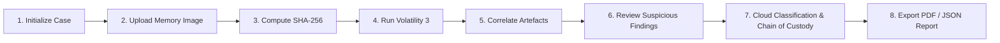

# Investigator User Guide & Platform Walkthrough

> **Platform:** Automated Cloud-Aware Memory Forensics Using Volatility 3  
> **Role:** Digital Forensics and Incident Response (DFIR) Analyst Manual

---

## 1. Introduction & Workflow Summary

Welcome to the **Automated Cloud-Aware Memory Forensics Platform**. This platform is an end-to-end investigative workbench designed to streamline the analysis of volatile memory dumps and cloud forensic artifacts.

---

## 2. Step-by-Step Module Walkthrough

### Module 1: Dashboard & Case Management
1. **Accessing the Dashboard:** Open your web browser and navigate to `http://127.0.0.1:8000/`.
2. **Reviewing Operations Health:** The dashboard displays real-time health metrics including Volatility 3 engine version, SQLite database status, staging disk space, and 8 live database statistics.
3. **Creating a Forensic Case:**
   - Click the **`+ New Forensic Case`** button in the header or dashboard.
   - Enter a unique **Case Number** (e.g., `CASE-2026-CLOUD-01`).
   - Specify the **Case Title** (e.g., `Investigation into Suspicious Outbound C2 Beaconing`).
   - Select the **Target Environment Scope** (`IaaS (Virtual Machine)`, `SaaS (Cloud Service Audit)`, or `On-Premises / Physical`).
   - Set the **Investigation Priority** (`Low`, `Medium`, `High`, `Critical`).
   - Enter your **Lead Investigator Name** and incident synopsis.
   - Click **`Initialize Case`**.

---

### Module 2: Memory Evidence Ingestion & SHA-256 Verification
1. Navigate to **Memory Evidence** (`/evidence`) from the sidebar.
2. **Uploading an Evidence File:**
   - Select the associated forensic case from the dropdown.
   - Choose an authorized memory dump file (`.raw`, `.mem`, or `.dmp`).
   - Select the **Acquisition Source** (e.g., `AWS EC2 Nitro Guest Snapshot`, `Azure VM Hypervisor Dump`).
   - Enter optional acquisition notes (e.g., `Frozen volatile memory snapshot taken prior to VPC network isolation`).
   - Click **`Upload & Verify Evidence`**.
3. **Cryptographic Ingestion:**
   - The platform streams the file through its 64KB chunk hasher, computing a cryptographic **SHA-256 hash** before saving the record.
   - The file is saved safely under a randomized UUID prefix, isolated from public web directories.
4. **On-Demand Integrity Verification:**
   - Click the **`Verify Integrity`** button next to any evidence file.
   - The system re-hashes the stored file on disk and compares it to the original baseline.
   - A green badge indicates **Verified (Matches Baseline)**. If the file is altered on disk, the system displays a prominent red warning: **MISMATCH — File May Be Altered**.

---

### Module 3: Volatility 3 Analysis Engine
1. Navigate to **Volatility Analysis** (`/analysis`) from the sidebar.
2. **Configuring an Analysis Session:**
   - Select an uploaded evidence file from the dropdown.
   - Choose the target operating system family (`Windows`, `Linux`, or `Automatic Detection`).
   - The system displays the available plugin catalog:
     - **Process Analysis:** `windows.pslist`, `windows.pstree`
     - **Network Sockets:** `windows.netscan`, `linux.sockstat`
     - **Command Line:** `windows.cmdline`, `linux.bash`
     - **Loaded Modules:** `windows.modules`, `windows.ldrmodules`
   - Select the plugins to execute (or click **Select All Recommended**).
3. **Executing Analysis:**
   - Click **`Execute Volatility Analysis`**.
   - The engine validates SHA-256 integrity first. If verified, it spawns the plugins asynchronously.
   - Review live execution progress, status codes (`Success`, `Empty`, `Unsupported`), and extracted row counts.

---

### Module 4: Evidence Correlation & Threat Detection
1. Navigate to **Artifact Correlation** (`/correlation`) from the sidebar.
2. Select the completed analysis session.
3. **Normalised Artifacts View:**
   - Inspect standardized forensic records for processes, sockets, command strings, and loaded drivers.
   - All records retain exact traceability to the source plugin and raw data.
4. **Parent-Child Process Tree:**
   - Explore interactive process hierarchies. Notice when interactive shells (`cmd.exe`) are spawned anomalously by non-interactive services (`services.exe`).
5. **Process-to-Network Socket Mapping:**
   - Directly identify which process PID generated an external connection (e.g., `powershell.exe` connected to remote IP `198.51.100.25:4444`).
6. **Suspicious Findings & Analyst Review:**
   - Review rule-based heuristic findings flagged by the system.
   - Click **`Review Finding`** to update the finding status (`Needs Review`, `Confirmed Suspicious`, `False Positive`, `Inconclusive`) and record investigative notes.
7. **Authentic Chronological Timeline:**
   - Inspect the unified forensic timeline reconstructing system boot, process launch, network connection, and command execution events in chronological order.

---

### Module 5: Cloud Evidence Governance
1. Navigate to **Cloud Evidence** (`/cloud-evidence`) from the sidebar.
2. **IaaS Evidence Registration:**
   - Register guest virtual machine memory snapshots (e.g., AWS EC2, Azure VM, GCP Compute Engine).
   - Enter Cloud Provider, VM Instance ID, Region, and Acquisition Method.
   - Notice the mandatory legal disclaimer: *Volatile memory analysis is restricted to the authorized guest virtual machine; direct access to the cloud provider's physical hypervisor RAM is strictly disclaimed.*
3. **SaaS Evidence Registration:**
   - Register SaaS audit and compliance exports (e.g., Microsoft 365 Unified Audit Log, Google Workspace Reports API).
   - The platform strictly enforces that *direct server RAM is inaccessible to SaaS customers* and scopes evidence to authenticated audit trails.
4. **Simulated Records:**
   - Check the **Is Simulated Demonstration Record** toggle for training or testing files. The record is permanently tagged with `[SIMULATED RECORD]` across all UI views and generated reports.
5. **Chain of Custody Ledger:**
   - Review the append-only ledger tracking evidence registration, integrity verifications, analyst review actions, and transfers with timestamps and investigator signatures.

---

### Module 6: Automated Forensic Reporting
1. Navigate to **Forensic Reports** (`/reports`) from the sidebar.
2. **Generating a Dossier:**
   - Select your case from the dropdown.
   - Enter a report title and investigator name.
   - Select output format (`Both PDF and JSON`, `PDF Only`, `JSON Only`).
   - Click **`Generate Forensic Report`**.
3. **Downloading the Dossier:**
   - **Download PDF:** A publication-ready multi-page dossier generated via ReportLab featuring two-pass page numbering ("Page X of Y"), metadata tables, finding summaries, and all 10 mandated sections.
   - **Download JSON:** A structured machine-readable JSON document ideal for archiving or importing into security information and event management (SIEM) systems.

---

### Module 7: Testing & Evaluation Center
1. Navigate to **Evaluation & Demo** (`/evaluation`) from the sidebar.
2. **Reviewing Empirical Metrics:**
   - View live metric cards for Recovery Coverage (100%), Plugin Success (100%), Processing Latency (0.09s), Repeatability (100%), Integrity (100%), and Automation Speedup (>1500x).
3. **Inspecting Experiments:**
   - Review detailed empirical tables for Experiments 1 through 7.
4. **Re-Running Benchmarks:**
   - Click the **`Re-Run Benchmarks`** button to trigger a live execution of the 7 empirical experiments and refresh the recorded metrics.

---

## 3. Frequently Asked Questions (FAQ) & Troubleshooting

### Q1: What file formats are supported for memory upload?
The platform strictly validates memory images by extension (`.raw`, `.mem`, `.dmp`) and file header. Extensions such as `.txt`, `.exe`, or `.pdf` are rejected with HTTP 422.

### Q2: How does the system handle missing Volatility symbols?
Volatility 3 stores symbol tables in `AppData/Roaming/volatility3/symbols` or its installation directory. If symbols for an obscure OS kernel are absent, the engine falls back gracefully to `banners.Banners` to identify the kernel without crashing.

### Q3: Why does SaaS evidence not support Volatility memory plugins?
Volatility analyzes physical RAM dumps. SaaS providers (e.g., Salesforce, Microsoft 365) operate shared, multi-tenant cloud hardware where customers have zero hypervisor access. SaaS evidence consists of API audit logs, which the platform classifies and preserves under strict chain of custody.
